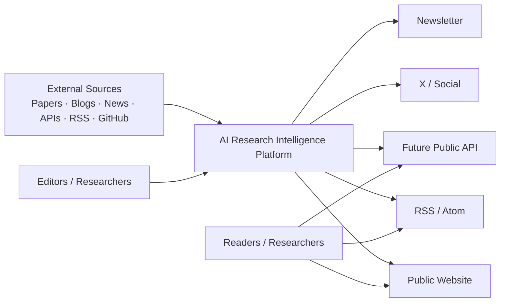

# 01 — System Context

## Boundaries

The platform owns canonical content, claims, evidence, topics, relationships, translations, publication status, and version history.

Editorial input is owned by the platform. The current local increment uses OS/database-authorized CLI commands; a hosted identity/authorization design is required before enabling editorial HTTP writes.
