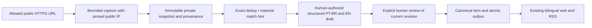

# 12 - First End-to-End Slice

Implemented scope: local administrative commands, not a hosted publishing operation.

Acceptance evidence and commands are in [local editorial operations](../local-editorial.md). Source bytes are never served by the public API. The operator supplies all claims, source metadata, localized text, limitations and reuse-rights confirmation. No AI provider or automatic translation is used. Exact URL/content retries are idempotent; whitespace-normalized cross-URL matches are review hints, not automatic semantic merges. Publication requires a separate explicit review transition and publishes both locales atomically. Published corrections continue to use immutable publication versions; post-publication editorial correction commands are outside this first local slice.
